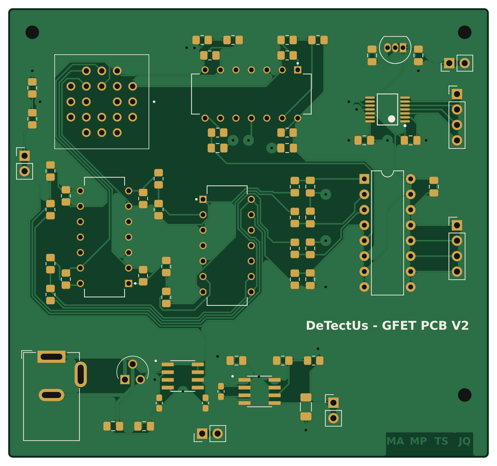
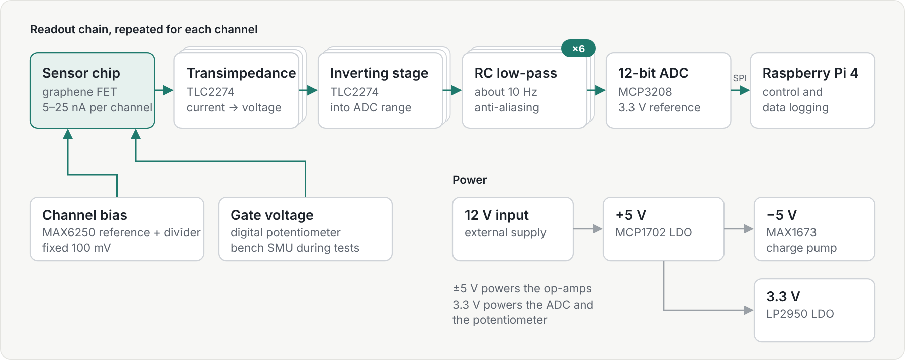
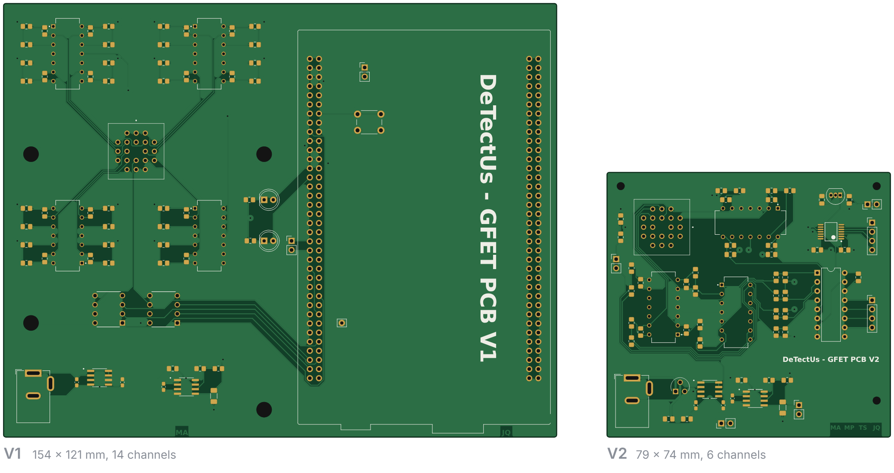
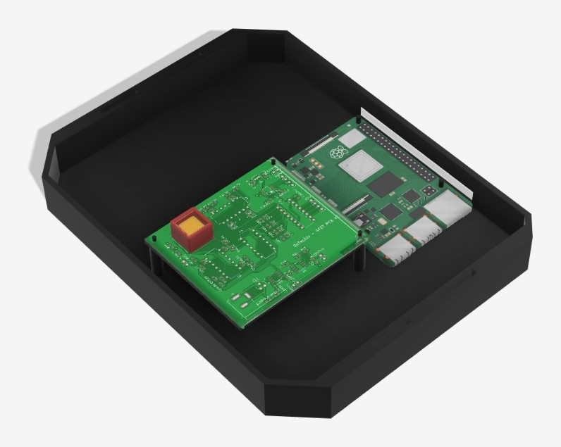
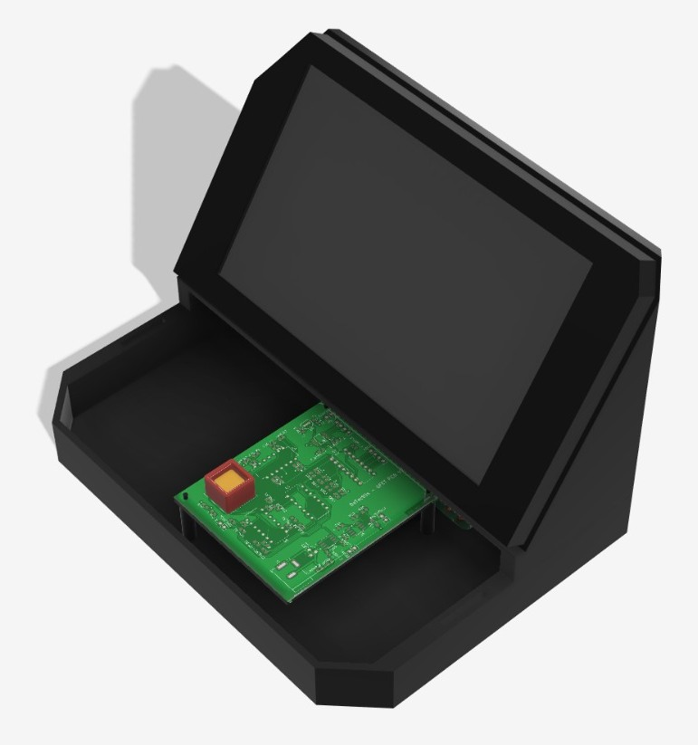
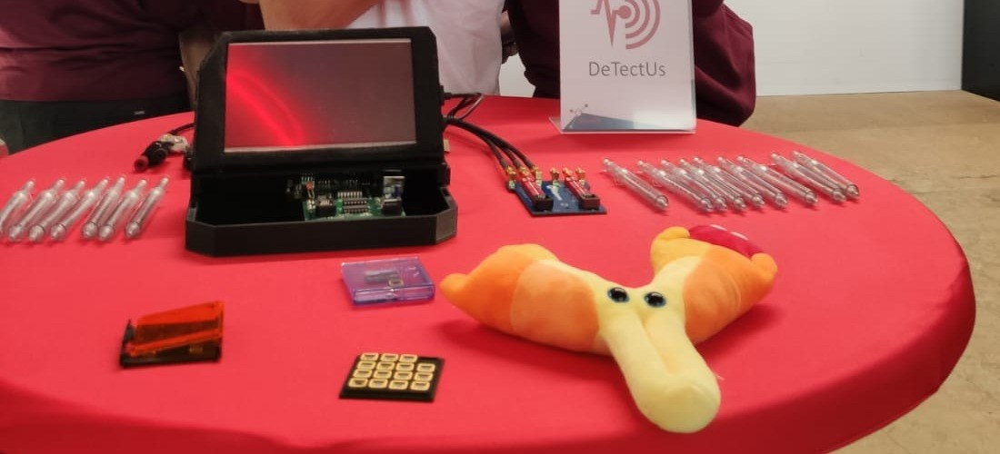
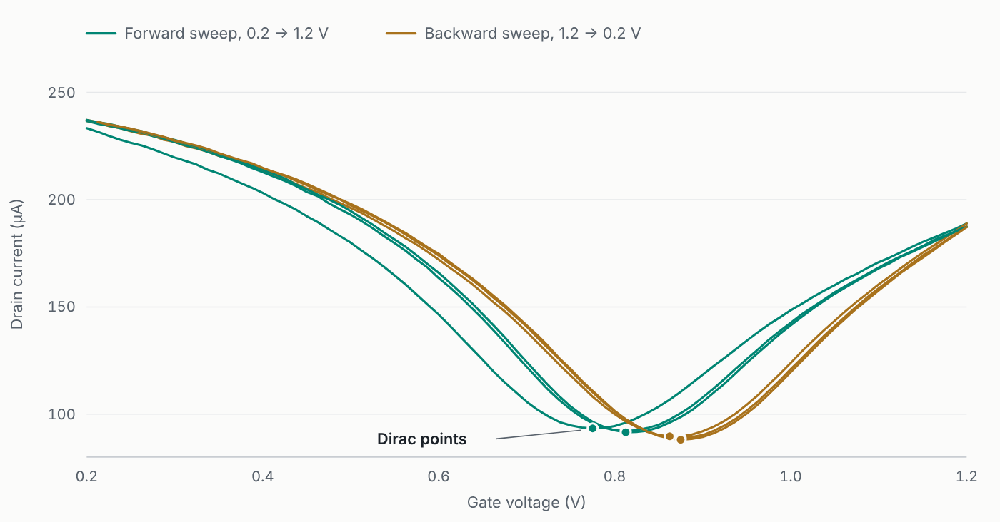

# Nanoamp readout for graphene FET sensors

A low-noise data acquisition board that measures currents of a few nanoamps from a graphene field-effect transistor chip. I led the electronics and took the board through two hardware versions.

| | |
|---|---|
| My role | Electronics lead, covering circuit design, layout, enclosure, bench testing and test software |
| Channels | 6 on V2, 14 on V1 |
| Current range | 5 to 25 nA |
| Resolution | 0.5 nA, measured |
| Inaccuracy | 0.05 to 0.1% in initial bench tests |
| Conversion | MCP3208, 12-bit, SPI, 3.3 V reference |
| Board | Two layers, 79 × 74 mm |
| Tools | KiCad, 3D printing, Python with PyVISA, MATLAB, Keithley source-measure units and multimeter |

## Context

I led the electronics for DeTectUs, a multidisciplinary DTU team taking part in SensUs, an international student competition for sensor prototypes. The team built its sensor around a commercial graphene FET chip from Graphenea with 14 channels. Most of the team worked on functionalising the graphene surface, while I was responsible for the hardware that reads the chip out.

The board holds each channel at a small fixed bias, sweeps the gate voltage and records the channel current, which sits between 5 and 25 nA. The signal is a shift in the gate voltage where the current reaches its minimum, known as the Dirac point.

## Signal chain

Every channel runs through the same chain. A TLC2274 transimpedance amplifier turns the channel current into a voltage, a second TLC2274 stage inverts it into the range of the ADC and an RC low-pass filter at about 10 Hz removes interference and prevents aliasing. A 12-bit MCP3208 ADC converts all six channels and a Raspberry Pi 4 reads it over SPI.

An external 12 V supply keeps mains conversion off the board. An MCP1702 LDO makes 5 V, a MAX1673 charge pump makes −5 V for the op-amps and an LP2950 LDO makes 3.3 V for the ADC and the digital potentiometer. A MAX6250 precision reference and a resistor divider set a fixed 100 mV channel bias. The on-board gate potentiometer was not finished in time, so a bench source-measure unit swept the gate during testing.

## From V1 to V2

V1 was a 154 × 121 mm board with 14 channels, an STM32 Nucleo board for conversion and control and two SPI digital potentiometers for the gate and bias. Measurements on the chips showed that channels 8 to 14 gave unstable readings. V2 reads six channels, adds the inverting stage, moves conversion to a dedicated 12-bit ADC and hands control to a Raspberry Pi 4. The chip socket sits next to the analog front end, the power section runs along the bottom edge and the bottom layer is a ground pour.

## Enclosure

I also designed the enclosure that turns the board into a standalone device. The 3D-printed base, 200 × 154 mm, holds the readout board next to a Raspberry Pi 4, and a tilted housing above them carries the display. The front stays open, so the chip socket can be reached to swap chips.

| Base with the V2 board and a Raspberry Pi 4 | With the display housing in place |
|---|---|
|  |  |

## Testing

Alongside the boards I built an automated bench setup to characterise the graphene FET chips themselves. A Python script controls two Keithley source-measure units over GPIB with PyVISA, one holding the bias across the channel and one sweeping the gate, and logs the drain current at every step. A MATLAB script then finds the Dirac point in each sweep. After the first sweep in each direction the Dirac point repeats at the same gate voltage, within the 12.5 mV step size, and backward sweeps find it about 60 mV higher than forward ones.

Both versions were built and tested on the bench, with a Keithley source-measure unit sweeping the gate and a Keithley multimeter reading the output, scripted in Python with PyVISA. In the first tests the readout stayed within 0.05 to 0.1% across the 5 to 25 nA range and resolved changes of 0.5 nA. The system was finished only a few days before the competition, so these results come from a small number of runs and the board was not used at the event itself.

## Repository contents

- `hardware/v2` KiCad 6 project for V2 (schematic, layout and project file)
- `hardware/v1` KiCad 6 project for V1
- `mechanical` STL files of the latest enclosure parts (base v9, top v8 in two parts)
- `software/bench` Python scripts for the gate sweeps, `testv3.py` for the chips and `testv3pcb.py` for the board
- `software/analysis` MATLAB scripts that find the Dirac point in each sweep
- `data` the gate sweeps shown above as CSV
- `images` renders, diagram, chart and photo used on this page

The board images are rendered directly from the KiCad layouts. The scripts are kept as they were used in the project.
